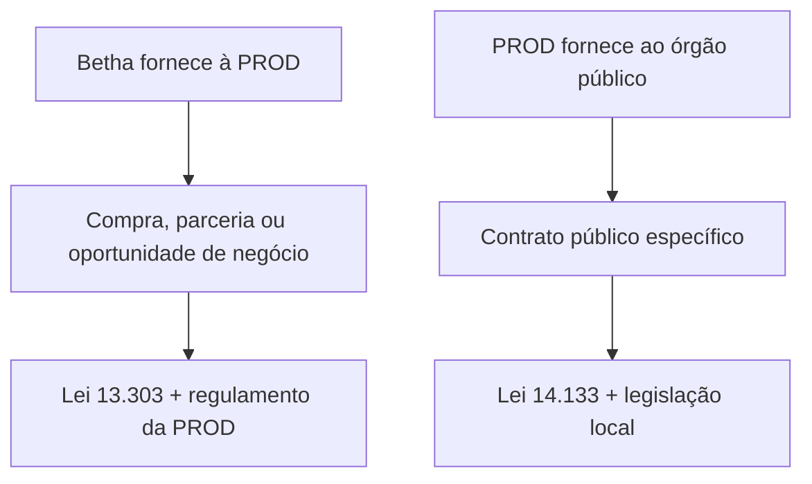

# PRODES

Conversa do ChatGPT de 2026-08-05 (última atividade 2026-11-03). Transcrição bruta: **fonte, não verdade curada**. Fatos relevantes devem ser promovidos para as páginas de pessoas, organizações, áreas e decisões.

**Anexos citados:** Agenda-SECOP-2026-V19.pptx.pdf, Flyer - Institucional .pdf, Flyers - App.pdf, Flyers - Gestão de Custos.pdf, Flyers - ObrasPro.pdf, Flyers - Planejamento estratégico.pdf

## Giuliano

Estou indo agora participar do evento SECOP 2026 (https://secop.org.br/) juntamente com algumas pessoas do time comercial e do marketing da empresa.

O CEO pediu a minha participação pois iremos comerçar a trabalhar a venda dos nossos produtos através das prodes.

Entendi a estratégia do CEO mas gostaria da sua análise sobre a minha interação nesta frente diante de todo o contexto que você possui da minha função e dos meus afazares no que diz respeito a canais.

Fazendo uma pequisa sobre atuação das prodes no mercado de softwares que a Betha atua, sobre toda a legislação que vigora sobre elas e sobre a minha atuação através de canais comerciais, produto e serviço, gostaria de sua análise para saber qual deve ser minha estratégia no stand que temos neste evento?

Segue um link sobre as prodes de SP e alguns materiais do evento e que iremos trabalhar no evento.
https://www.prodesp.sp.gov.br/clientes/acordos-de-produtos-e-servicos/ibm?cn-reloaded=1

## ChatGPT

Vou cruzar três frentes: a agenda e os materiais do estande, o modelo jurídico-comercial das PRODs/PRODEs e o seu papel na Betha. Como os PDFs são centrais e o tema jurídico exige atualização, vou usar a leitura estruturada de PDFs e validar legislação e fontes oficiais na web.

## ChatGPT

A primeira leitura já mostra um ponto importante: a SECOP não é uma feira de “leads municipais” comum; ela concentra presidentes e dirigentes das empresas públicas de TIC e pautas de transformação digital. Vou tratar o estande como ambiente de desenvolvimento de canal institucional — com qualificação de modelo, governança, contratação e capacidade de entrega — e não apenas demonstração de produto.

## ChatGPT

Sua participação no SECOP deve ter um objetivo diferente do time comercial: você não está ali principalmente para vender uma licença, mas para descobrir como transformar as PRODs em um novo tipo de canal institucional da Betha.

Minha recomendação central é: posicione-se como o arquiteto do modelo de parceria Betha–PRODs, conectando produto, serviços, comercial, implantação, suporte, contratos e convivência com as revendas atuais.

## 1. O que essa estratégia representa para a Betha

As PRODs — empresas públicas estaduais de tecnologia, muitas vezes chamadas de PRODEs — ocupam uma posição singular:

- Conhecem a arquitetura tecnológica, os projetos prioritários e as restrições do governo estadual.
- Possuem relacionamento institucional e contratos com órgãos públicos.
- Podem operar soluções próprias, integrar soluções privadas e formar acordos com fabricantes.
- Em determinados modelos, funcionam como integradoras, contratantes, comercializadoras ou prestadoras perante órgãos estaduais e municípios.
- Têm legitimidade institucional, mas também processos decisórios, jurídicos e técnicos mais complexos que os de uma revenda privada.

A própria SECOP foi desenhada para reunir dirigentes dessas empresas e gestores públicos das três esferas, não sendo uma feira comercial convencional. O tema de 2026 — governança de dados e IA como infraestrutura estratégica — reforça que o comprador estará pensando em arquitetura de governo, soberania, integração e políticas públicas, e não somente em funcionalidades de software. [SECOP 2026](https://secop.org.br/2026/07/22/brasilia-recebe-secop-2026-com-foco-em-ia-e-governanca-de-dados-no-setor-publico/)

Portanto, a oportunidade não é simplesmente:

> “A PROD revender os sistemas Betha.”

A oportunidade maior é:

> “A Betha fornecer uma plataforma de soluções de gestão pública que a PROD possa incorporar à sua oferta, integrar ao ecossistema estadual e levar a órgãos e municípios com segurança comercial, técnica e jurídica.”

## 2. Qual deve ser o seu papel

Dentro do contexto da sua gerência, essa frente pertence naturalmente a Canais, mas não deve nascer como uma extensão improvisada do modelo de revendas.

Sua função deveria abranger cinco responsabilidades:

| Dimensão | Sua responsabilidade |
|---|---|
| Estratégia de canal | Definir quais PRODs têm aderência, território, produtos prioritários e capacidade comercial |
| Modelo comercial | Estruturar margem, composição de preço, registro de oportunidade, metas e proteção dos canais existentes |
| Produtos | Traduzir necessidades estaduais para Produto sem prometer customizações individualmente |
| Serviços | Definir quem implanta, integra, capacita, sustenta e atende cada nível de suporte |
| Governança | Coordenar jurídico, financeiro, comercial, produto, serviços e parceiros privados |

Isso fortalece a estrutura que você já está construindo: o futuro coordenador comercial de revendas cuidaria do desenvolvimento comercial dos canais privados, enquanto o coordenador de serviços apoiaria implantação, suporte técnico e ecossistema de parceiros. As PRODs ficariam sob sua governança estratégica, pelo menos até o modelo estar validado.

Minha leitura é que o CEO não o levou apenas para ajudar a atender o estande. Ele precisa que você ajude a descobrir se há um canal viável por trás das conversas comerciais.

## 3. O cuidado jurídico essencial

Existem duas relações jurídicas diferentes, e elas não podem ser confundidas:

### Betha → PROD

Quando uma empresa pública contrata produtos ou serviços de terceiros, a regra geral da Lei nº 13.303/2016 é a realização de licitação, ressalvadas dispensas, inexigibilidades e hipóteses específicas. O art. 28, §3º, contempla situações relacionadas à comercialização de produtos ligados ao objeto social da estatal e oportunidades de negócio com parceiros escolhidos por características particulares, mas isso precisa ser fundamentado pela própria PROD e pelo seu regulamento interno. [Lei nº 13.303/2016, arts. 28 a 30](https://www.planalto.gov.br/ccivil_03/_ato2015-2018/2016/lei/l13303.htm)

Portanto, a conversa de estande não deve partir da afirmação de que “a PROD pode contratar diretamente a Betha”. A pergunta correta é:

> “Qual instrumento essa PROD utiliza para incorporar soluções privadas ao seu portfólio?”

Pode ser acordo comercial, oportunidade de negócio, credenciamento, licitação, contratação por inexigibilidade ou outro procedimento admitido pelo regulamento interno.

### PROD → órgão público

A contratação da PROD por um órgão público também não é automaticamente dispensada. O art. 75, IX, da Lei nº 14.133 admite dispensa para bens ou serviços fornecidos por órgão ou entidade da Administração criado para aquele fim específico, desde que o preço seja compatível com o mercado. A aplicabilidade precisa ser demonstrada em cada contratação. [Lei nº 14.133/2021, art. 75, IX](https://www.planalto.gov.br/ccivil_03/_ato2019-2022/2021/lei/l14133.htm)

Também pode haver inexigibilidade quando existir inviabilidade real de competição, mas exclusividade comercial criada apenas para facilitar a contratação não resolve, sozinha, o requisito jurídico. [Lei nº 14.133/2021, art. 74](https://www.planalto.gov.br/ccivil_03/_ato2019-2022/2021/lei/l14133.htm)

### O exemplo da PRODESP

O caso apresentado por você é uma excelente referência comercial. A PRODESP mantém diversos acordos com fabricantes como IBM, Microsoft, Oracle, MongoDB, Salesforce e outros. [Acordos de Produtos e Serviços da PRODESP](https://www.prodesp.sp.gov.br/clientes/acordos-de-produtos-e-servicos)

No acordo com a Microsoft, por exemplo, a finalidade declarada é viabilizar a contratação de produtos e serviços pela PRODESP mediante procedimentos técnico-operacionais e condições comerciais favoráveis. [Acordo Microsoft–PRODESP](https://www.prodesp.sp.gov.br/clientes/acordos-de-produtos-e-servicos/microsoft)

No caso Oracle, a PRODESP registra expressamente que:

- Órgãos e municípios podem ser beneficiários.
- Cada interessado deve elaborar seu projeto.
- Os preceitos legais continuam aplicáveis.
- A escolha técnica do produto precisa ser justificada.
- A contratação é celebrada com a PRODESP.

[Acordo Oracle–PRODESP](https://www.prodesp.sp.gov.br/clientes/acordos-de-produtos-e-servicos/oracle)

Esse é o ponto-chave: o acordo cria uma rota comercial e operacional, mas não elimina a necessidade de fundamentação da contratação pública.

## 4. Estratégia no estande

### Seu objetivo no primeiro dia

Você deveria sair do evento com:

- 5 a 8 PRODs qualificadas.
- 2 ou 3 candidatas a projeto-piloto.
- Identificação do modelo de parceria usado por cada uma.
- Um patrocinador executivo e um interlocutor comercial/técnico por PROD.
- Uma hipótese de produto prioritário por estado.
- Próxima reunião agendada, com pauta e participantes definidos.

Não me concentraria em quantidade de cartões ou contatos.

### Divisão de papéis no estande

| Pessoa | Papel |
|---|---|
| Marketing | Atrair, comunicar posicionamento e registrar contato |
| Comercial | Identificar demanda, órgão, oportunidade e orçamento |
| Você | Qualificar a PROD como canal e mapear o modelo operacional |
| Especialista de produto | Demonstrar aderência e esclarecer requisitos |
| Executivo Betha | Desenvolver relacionamento institucional com dirigentes |

Quando entrar um dirigente de PROD, o comercial pode apresentar a Betha, mas você deve conduzir a segunda parte da conversa.

## 5. Roteiro recomendado para a conversa

### Abertura de 30 segundos

> “Sou responsável pela estratégia de canais da Betha. Estamos avaliando como nossas soluções podem complementar o portfólio das empresas públicas de tecnologia, não apenas por uma relação de fornecimento, mas com um modelo estruturado de comercialização, implantação, integração e sustentação. Gostaria de entender como vocês trabalham hoje com fabricantes privados e quais lacunas de gestão pública pretendem atender.”

Essa abordagem o diferencia de um vendedor e o coloca no nível adequado para conversar com presidentes, diretores comerciais e diretores técnicos.

### Perguntas de qualificação

Não comece demonstrando todos os produtos. Pergunte:

1. A empresa comercializa soluções de fabricantes privados ou trabalha somente com desenvolvimento próprio?
2. Qual instrumento utiliza: acordo comercial, credenciamento, licitação, parceria por oportunidade de negócio ou outro?
3. A atuação é concentrada no governo estadual ou inclui municípios?
4. Quais áreas têm maior demanda não atendida atualmente?
5. A PROD quer apenas contratar a licença ou incorporar a solução ao seu portfólio?
6. Quem realiza prospecção, proposta, implantação, integração, suporte e faturamento?
7. Existe exigência de hospedagem própria, nuvem governamental ou residência de dados?
8. Quais integrações estaduais seriam indispensáveis?
9. A solução precisa usar a identidade da PROD ou pode ser apresentada como Betha?
10. Existe conflito com algum produto próprio ou contrato vigente?
11. Como a PROD seleciona parceiros privados?
12. Qual seria um projeto realista para validar o modelo nos próximos 90 a 180 dias?

A pergunta mais importante é:

> “Se decidíssemos avançar amanhã, qual seria o processo interno até a primeira contratação?”

Ela transforma interesse genérico em processo concreto.

## 6. Como posicionar os produtos apresentados

Os flyers estão visualmente consistentes, mas foram produzidos na lógica de venda ao usuário final. Com as PRODs, você precisa acrescentar uma camada de valor institucional.

### Planejamento Estratégico

Provavelmente é a melhor porta de entrada transversal.

Posicionamento:

> Plataforma de governança da execução estratégica, conectando plano de governo, PPA, orçamento, projetos, metas e indicadores.

Interlocutores:

- Presidência da PROD.
- Secretarias de Planejamento e Administração.
- Casas Civis.
- Controladorias.

Pergunta:

> “O estado consegue hoje acompanhar, em um ambiente único, se o orçamento e os projetos estão entregando as promessas do plano de governo?”

### Gestão de Custos

É uma solução forte para estados, especialmente diante de pressão por eficiência e qualidade do gasto.

Posicionamento:

> Camada analítica que integra dados financeiros e operacionais para demonstrar quanto custa cada política, unidade e serviço público.

Interlocutores:

- SEFAZ.
- Planejamento.
- Controladoria.
- Saúde e Educação.
- Tribunais e órgãos autônomos.

Pergunta:

> “O estado conhece apenas a despesa contábil ou consegue calcular o custo efetivo de cada serviço entregue à população?”

É importante não restringir a conversa a compliance contábil. O ganho executivo é apoiar priorização orçamentária, eficiência e justificativa de investimentos.

### ObrasPro

Tem boa aderência para infraestrutura estadual e municipal.

Posicionamento:

> Governança digital do ciclo da obra pública, com planejamento, orçamento, fiscalização, medição, transparência e gestão do fornecedor.

Interlocutores:

- Infraestrutura.
- Transportes.
- Educação e Saúde, pelas obras de escolas e hospitais.
- Municípios atendidos pela PROD.
- Controladoria.

Pergunta:

> “A gestão estadual consegue enxergar em tempo real onde cada obra está, por que atrasou e qual impacto financeiro está sendo produzido?”

### App

Deve ser apresentado como plataforma de experiência do cidadão, não como um aplicativo isolado.

Posicionamento:

> Porta digital unificada para serviços públicos, integrada aos sistemas existentes, com identidade do governo ou da PROD.

Interlocutores:

- Transformação digital.
- Atendimento ao cidadão.
- Comunicação.
- Prefeituras.
- Equipes responsáveis por portais e identidade digital.

Pergunta:

> “O cidadão acessa os serviços em uma jornada única ou ainda precisa descobrir qual órgão e qual sistema atendem cada necessidade?”

Aqui, confirme white label, APIs, autenticação, identidade digital, LGPD, acessibilidade, notificações e analytics antes de assumir compromissos.

## 7. Agenda política de relacionamento

Pela agenda enviada, eu priorizaria contato com:

- PRODESP/SP.
- PRODEMGE/MG.
- PROCERGS/RS.
- PRODEB/BA.
- PRODEPA/PA.
- ETICE/CE.
- CIASC/SC.
- ETIPI/PI.
- ITEC/AL.

O painel “ABEP-TIC apoiando a transformação digital dos municípios”, com participação da PRODESP, é particularmente estratégico para você. É exatamente a interseção entre PRODs, municípios e canais Betha.

Ao abordar presidentes, não tente concluir o desenho operacional. Busque autorização e patrocínio:

> “Gostaria de estruturar com sua equipe um projeto-piloto e compreender formalmente o modelo de parceria utilizado pela empresa. Quem você recomenda envolver nessa construção?”

Depois, desça para os interlocutores comercial, jurídico, técnico e de portfólio.

## 8. O maior risco: conflito com as revendas atuais

Essa frente pode gerar crescimento, mas também conflito de canal. A Betha precisa definir antes da escala:

- Se a PROD terá exclusividade territorial ou não.
- Como ficam os clientes e oportunidades já trabalhados por revendas.
- Quem será dono do relacionamento com o município.
- Se uma revenda poderá implantar uma oportunidade vendida pela PROD.
- Como será o registro e a proteção das oportunidades.
- Quem recebe pela licença, serviços e suporte.
- Qual canal prevalece quando PROD e revenda chegam ao mesmo negócio.
- Se a PROD atenderá apenas o estado ou também municípios.
- Quais produtos poderão fazer parte do acordo.

Minha recomendação é não oferecer exclusividade estadual no início. Comece com:

- Acordo não exclusivo.
- Produto e território delimitados.
- Projeto-piloto.
- Registro de oportunidades.
- Proteção da base instalada e dos negócios já registrados.
- Revisão após seis meses.

As PRODs podem inclusive se tornar canais âncora, enquanto revendas e parceiros de serviços executam implantação, capacitação e atendimento local. Isso permite complementariedade, em vez de substituição automática.

## 9. O que você não deve prometer no evento

Evite comprometer:

- Contratação direta ou dispensa de licitação.
- Exclusividade estadual.
- Percentual de margem.
- Customização sem avaliação de Produto.
- Integração sem diagnóstico técnico.
- SLA diferente do padrão.
- Implantação nacional pela equipe Betha.
- White label automático.
- Prazo de entrada em produção.
- Acesso irrestrito a dados ou código-fonte.

Use esta resposta:

> “Esse ponto faz parte do desenho da parceria. Vou registrá-lo para validarmos conjuntamente com Produto, Serviços e Jurídico antes da proposta formal.”

## 10. Registro mínimo de cada conversa

Peça ao marketing para registrar estes campos:

| Campo | Conteúdo |
|---|---|
| PROD/Estado | Entidade e território |
| Contato | Nome, função e poder de decisão |
| Mercado | Estado, municípios ou ambos |
| Dor prioritária | Problema concreto |
| Produto aderente | Produto Betha associado |
| Modelo atual | Como trabalha com parceiros privados |
| Papel esperado | Revenda, integradora, contratante ou operadora |
| Infraestrutura | Nuvem, dados, APIs e integrações |
| Projeto possível | Órgão ou município candidato |
| Próximo passo | Reunião, documentos e responsáveis |
| Prazo | Data de retorno |

Classifique cada conversa:

- **A:** há demanda, processo de parceria conhecido e patrocinador.
- **B:** há aderência, mas falta projeto ou processo.
- **C:** relacionamento institucional sem oportunidade identificada.

## Recomendação final

Sua postura no estande deve ser 20% apresentação e 80% escuta estruturada.

Você não precisa sair da SECOP com acordos prometidos. Precisa sair com evidências suficientes para responder ao CEO:

1. Quais PRODs realmente podem atuar como canais.
2. Em quais estados e produtos.
3. Por qual instrumento jurídico-comercial.
4. Com qual modelo de implantação e sustentação.
5. Com quais riscos para as revendas atuais.
6. Quais duas ou três parcerias merecem um piloto.

A frase que melhor resume sua atuação é:

> “Não estou aqui apenas para identificar quem pode vender Betha; estou identificando com quem conseguimos construir uma oferta pública sustentável, contratável, implantável e escalável.”

## Giuliano

Deixa eu te passar que está no stand comigo:

Débora: Diretora Comercial Interina
Danilo: Gerente de Expansão Estadual
Paloma: Gerente de MKT
Gisele: Responsável pelos eventos no MKT.

## ChatGPT

Com essa composição, seu papel fica ainda mais claro: você deve liderar a qualificação das PRODs como canal, enquanto Débora conduz o relacionamento executivo, Danilo explora as oportunidades estaduais e o Marketing organiza atração, narrativa e registro.

O risco agora é vocês quatro conversarem com a mesma pessoa sob óticas diferentes, sem produzir uma visão única. Recomendo um alinhamento rápido de cinco minutos no estande.

## Divisão prática de papéis

| Pessoa | Papel principal no SECOP | O que precisa obter |
|---|---|---|
| Débora | Relacionamento executivo e posicionamento comercial | Patrocínio de presidentes e diretores, abertura institucional e autorização para avançar |
| Danilo | Identificação da oportunidade estadual | Órgãos demandantes, projetos, orçamento, concorrentes e oportunidade concreta |
| Você | Qualificação e desenho do canal PROD | Modelo de parceria, processo de entrada, responsabilidades, serviços e conflitos de canal |
| Paloma | Posicionamento e inteligência de mercado | Percepção da marca, mensagens que geram interesse e padrões de demanda |
| Gisele | Operação, registro e continuidade | Contatos completos, classificação, agenda e próximos passos |

## Como a conversa deveria fluir

### 1. Abordagem e identificação — Paloma/Gisele

Elas identificam:

- Empresa ou órgão.
- Estado.
- Cargo.
- Interesse inicial.
- Produto que chamou atenção.

Se for alguém de PROD, presidente, diretor ou gestor estratégico, acionam Débora e você.

### 2. Abertura institucional — Débora

Débora apresenta a Betha e estabelece o nível executivo:

> “A Betha possui mais de 40 anos de atuação em gestão pública e está estruturando uma frente de relacionamento com as empresas públicas de tecnologia. Queremos compreender como nossas soluções podem complementar o portfólio e os projetos de transformação digital de cada estado.”

Se for presidente ou diretor de PROD, ela deve permanecer na conversa para construir confiança institucional.

### 3. Oportunidade estadual — Danilo

Danilo investiga o mercado final:

- Qual secretaria ou órgão possui a demanda?
- É uma iniciativa estadual ou destinada aos municípios?
- Existe projeto em elaboração?
- Há orçamento ou planejamento de contratação?
- Existe solução concorrente ou atualmente utilizada?
- Qual é a urgência?

Ele olha para o **negócio no estado**.

### 4. Modelo de canal — você

Você entra para entender como a oportunidade poderia acontecer:

- A PROD quer usar, revender, integrar ou operar a solução?
- Como ela seleciona fabricantes privados?
- Qual instrumento utiliza?
- Quem comercializa para o órgão?
- Quem apresenta a proposta?
- Quem implanta e integra?
- Quem presta suporte?
- Quem fatura o cliente?
- Existe política de margem ou remuneração?
- A atuação alcança os municípios?
- Há interesse em white label?
- Existem soluções próprias concorrentes?

Você olha para a **capacidade de transformar aquele negócio em uma operação recorrente e escalável**.

## Diferença entre você e Danilo

Essa distinção é importante para não haver sobreposição:

| Danilo – Expansão Estadual | Você – Canais |
|---|---|
| “Onde existe oportunidade?” | “Por qual canal ela acontecerá?” |
| Identifica órgão e demanda | Qualifica a PROD |
| Desenvolve o mercado estadual | Estrutura a parceria |
| Avalia potencial comercial | Define governança comercial |
| Conduz a oportunidade final | Organiza a capacidade de repetição |
| Busca receita no estado | Constrói um canal sustentável |

Exemplo:

> Danilo identifica que a Secretaria de Planejamento de determinado estado precisa de uma solução para acompanhar o plano de governo.

A partir disso, você verifica:

> A PROD daquele estado poderia incorporar o Planejamento Estratégico Betha ao portfólio? Por qual instrumento? Quem venderia, implantaria, integraria e sustentaria?

Assim, vocês são complementares.

## Como dividir por perfil de visitante

### Presidente ou diretor de PROD

Participantes: Débora + você.

Objetivo:

- Validar interesse estratégico.
- Identificar modelo de parceria.
- Conseguir indicação dos responsáveis comercial, técnico e jurídico.
- Agendar reunião pós-evento.

Pergunta de Débora:

> “Quais soluções vocês procuram incorporar ao portfólio nos próximos ciclos?”

Sua pergunta:

> “Como vocês estruturam hoje a entrada de fabricantes privados e quem deveríamos envolver para avaliar um projeto-piloto?”

### Diretor comercial ou de negócios da PROD

Participantes: você + Danilo.

Objetivo:

- Entender portfólio, território, margem e processo comercial.
- Identificar demanda concreta.
- Mapear como a PROD vende aos órgãos e municípios.

### Diretor técnico, CIO ou arquiteto

Participantes: você + alguém que tenha domínio do produto; Danilo quando houver projeto.

Objetivo:

- Hospedagem e soberania de dados.
- APIs e integrações.
- Segurança e LGPD.
- Identidade, autenticação e interoperabilidade.
- Modelo de implantação e sustentação.

Não aprofundem arquitetura sem especialista. Registrem os requisitos para uma reunião técnica.

### Secretário ou gestor de órgão público

Participantes: Danilo + Débora.

Objetivo:

- Qualificar a demanda final.
- Identificar prioridade e patrocinador.
- Entender se a PROD estadual participa da estratégia.

Você entra se surgir a possibilidade de contratação ou operação por meio da PROD.

### Município ou potencial cliente final

Danilo conduz. Você participa apenas se houver discussão sobre revenda, PROD ou parceiro de serviços.

## Um combinado importante para o estande

Quando alguém demonstrar interesse, não façam cinco apresentações seguidas. Usem uma transição natural:

> “Danilo, conte um pouco mais sobre a oportunidade no estado.”

Depois:

> “Giuliano, considerando que estamos falando de atuação por meio da PROD, consegue explorar como esse modelo poderia ser estruturado?”

Isso dá organização e transmite maturidade.

## Meta individual para cada um

- **Débora:** abrir relacionamento com pelo menos cinco presidentes ou diretores.
- **Danilo:** identificar de três a cinco oportunidades estaduais concretas.
- **Você:** qualificar pelo menos cinco PRODs e selecionar duas candidatas a piloto.
- **Paloma:** identificar quais mensagens e produtos mais geram interesse.
- **Gisele:** garantir 100% dos contatos registrados com responsável e próximo passo.

## Reunião rápida no final do dia

Façam uma triagem de 20 minutos:

1. Qual PROD conversou conosco?
2. Qual oportunidade foi identificada?
3. Qual produto tem aderência?
4. Quem é o patrocinador?
5. Como funciona a entrada de parceiros?
6. Quem será o dono do próximo passo?
7. Qual reunião precisa ser marcada?

Regra simples de ownership:

- Relacionamento com presidente/diretoria: Débora.
- Oportunidade estadual e órgão demandante: Danilo.
- Parceria, canal, serviços e governança: você.
- Comunicação e materiais: Paloma.
- Registro, agenda e logística: Gisele.

Seu principal resultado no evento não será necessariamente uma venda. Será entregar à Débora e ao CEO um mapa mostrando onde existe negócio, quais PRODs podem se tornar canal e o que a Betha precisa organizar internamente para viabilizar cada parceria.

## Giuliano

Com base no documento da programação quais palestras que você acredita fazerem sentido para eu assistir?

## ChatGPT

Vou filtrar a programação pelo que mais contribui para sua missão específica: relacionamento com dirigentes das PRODs, transformação digital de estados e municípios, modelos de contratação e construção do canal — preservando também os horários em que o networking no estande pode valer mais que uma palestra.

## ChatGPT

Com base na sua missão no evento, eu priorizaria as palestras que ajudam a entender como as PRODs pensam, estruturam parcerias, atendem municípios e incorporam soluções privadas. Não vale ficar fora do estande assistindo a conteúdos muito técnicos sobre IA, infraestrutura ou segurança sem relação direta com o canal.

## Agenda prioritária para você

### 5 de agosto — imperdíveis

| Horário | Sessão | Por que assistir |
|---|---|---|
| 11:10–12:00 | **Painel 1 — Estado Inteligente: Governança de Dados e IA como Infraestrutura Estratégica de Governo** | Reúne presidentes de PRODEMGE, CIASC, ETICE, PRODEPA, ITEC e outros. É uma leitura direta das prioridades estratégicas das PRODs. |
| 15:00–15:45 | **Painel 2 — ABEP-TIC apoiando a transformação digital dos municípios** | É a sessão mais alinhada à estratégia Betha: PRODs, transformação municipal e PRODESP no mesmo debate. |
| 16:15–16:35 | **Campfire Tema 1 — Como operacionalizar acordos com Big Techs e parcerias com startups** | Roberto Tostes, presidente da PRODEMGE, falará exatamente sobre operacionalização de acordos e parcerias. É provavelmente o conteúdo mais valioso para sua função. |
| 16:40–17:00 | **Campfire Tema 7 — O governo inteligente começa antes da IA** | Palestra do Danilo. Além de apoiar o colega, observe quem participa e quais dirigentes demonstram interesse. Esse público é uma fonte natural de conversas para o estande. |
| 17:50–18:00 | **Modelos de contratação de IA para o setor público** | Curta, mas útil para compreender como o mercado está construindo justificativas e caminhos de contratação de tecnologia. |

### Sequência ideal na tarde do dia 5

Você consegue fazer este circuito sem conflito:

1. 15:00–15:45 — Painel sobre transformação digital dos municípios.
2. 15:45–16:10 — Volta ao estande e contatos rápidos.
3. 16:15–16:35 — Campfire da PRODEMGE sobre acordos e parcerias.
4. 16:40–17:00 — Palestra do Danilo.
5. 17:00 em diante — Abordagem dos participantes e retorno ao estande.
6. 17:50–18:00 — Modelos de contratação.

Essa sequência praticamente forma uma trilha personalizada para a sua função.

## 6 de agosto — imperdíveis

| Horário | Sessão | Por que assistir |
|---|---|---|
| 14:00–14:45 | **Painel 4 — Como a tecnologia está redesenhando o serviço público** | Reúne dirigentes da PRODEST, ITI, EMGETIS e secretárias estaduais de Administração e Planejamento. Ajuda a entender o lado da PROD e o lado do cliente estadual. |
| 15:50–16:05 | **Prodesp for Startups: Parcerias para inovar conectando Governo, Startups e Cidadãos** | Essencial. Será apresentada por André Sucupira, Diretor Jurídico de Governança e Inovação da PRODESP. Pode revelar critérios jurídicos e de governança para entrada de parceiros privados. |

A sessão da PRODESP é especialmente importante porque o palestrante vem do Jurídico, Governança e Inovação. Escute procurando respostas para:

- Como a PRODESP seleciona parceiros.
- Qual instrumento utiliza.
- Como diferencia fornecedor de parceiro estratégico.
- Como a oportunidade é validada.
- Como preserva concorrência e justificativa de escolha.
- Como transforma a parceria em oferta ao governo.

Ao final, sua abordagem pode ser:

> “André, sou responsável por Canais na Betha Sistemas. Estamos estruturando uma frente para disponibilizar soluções de gestão pública por meio das empresas estaduais de tecnologia. A sua apresentação trouxe exatamente o tipo de modelo que estamos estudando. Qual seria o caminho inicial para avaliarmos a aderência da Betha à estratégia de parcerias da PRODESP?”

## Sessões recomendadas, se o movimento permitir

### 5 de agosto

**10:05–10:50 — Índice ABEP-TIC de Oferta de Serviços Públicos Digitais**

É útil para identificar os estados mais maduros digitalmente. O índice pode ajudar a segmentar as PRODs:

- Mais maduras: potenciais integradoras e canais estruturados.
- Intermediárias: candidatas a soluções prontas para acelerar entregas.
- Menos maduras: oportunidades maiores, mas com maior necessidade de serviços.

**16:20–16:45 — Apoio para transformação digital de estados e municípios**

Ajuda a compreender como projetos de transformação são estruturados, mas há conflito parcial com a palestra da PRODEMGE às 16:15. Priorize a PRODEMGE.

**17:30–17:45 — Governança de dados e IA em projetos de infraestrutura**

Pode gerar conexão com ObrasPro, principalmente porque o palestrante é o Secretário Adjunto de Infraestrutura e Mobilidade de Minas Gerais. Entretanto, o valor maior pode estar em abordá-lo depois da palestra, em conjunto com Danilo.

### 6 de agosto

**9:00–9:45 — Infraestrutura suportando o futuro dos serviços públicos**

Reúne dirigentes da MTI/MT, PRODAM/AM, ATI/PE, Serpro, Dataprev e Telebras. O conteúdo pode ser técnico, mas é um excelente mapa de interlocutores.

**10:50–11:10 — Automação de Serviços Públicos em Larga Escala: o caso ba.gov.br**

Campfire com Rogério Vassoler, da PRODEB. É relevante para o App Betha e para entender como uma PROD organiza uma plataforma estadual de serviços digitais.

**11:15–11:35 — CentralGov: como centralizamos a gestão, faturas e operações do Governo do ES**

Campfire da PRODEST. Pode trazer pistas sobre o papel operacional assumido pela empresa estadual e sobre as soluções que ela prefere desenvolver, integrar ou contratar.

**10:45–11:10 — Governança e Inovação Pragmática**

Boa conexão com Planejamento Estratégico, mas não é tão diretamente relacionada ao desenho de canais.

## Minha classificação final

### Prioridade máxima

1. Painel 2 — Transformação digital dos municípios.
2. Campfire PRODEMGE — Operacionalização de acordos e parcerias.
3. Prodesp for Startups — Parcerias, governo e cidadãos.
4. Painel 1 — Presidentes das PRODs.
5. Painel 4 — Tecnologia redesenhando o serviço público.
6. Palestra do Danilo.

### Prioridade secundária

7. Índice de Serviços Públicos Digitais.
8. Caso ba.gov.br da PRODEB.
9. CentralGov da PRODEST.
10. Modelos de contratação de IA.

## O que observar durante as sessões

Não assista apenas para absorver o conteúdo. Registre:

- Problemas que as PRODs dizem não conseguir resolver sozinhas.
- Uso das palavras “parceria”, “ecossistema”, “acordo”, “contratação” e “municípios”.
- Estados que querem ampliar atuação municipal.
- Necessidades de integração e soberania de dados.
- Soluções que as PRODs já possuem e podem conflitar com a Betha.
- Nomes de diretores comerciais, jurídicos, técnicos e de inovação.
- Casos em que a PROD incorporou tecnologia privada ao portfólio.
- Critérios usados para escolher parceiros.

Depois de cada palestra prioritária, tente falar com o palestrante antes de voltar ao estande. Uma conversa de três minutos com Roberto Tostes ou André Sucupira provavelmente terá mais valor para a estruturação do canal do que assistir a várias palestras técnicas completas.

## Giuliano

Não sei no documento da programação tem as empresas que terão stand. Se tiver e você conseguir faça uma análise de quais empresas vai sentido eu visitar o stand deles por favor.

## ChatGPT

Vou verificar a seção de patrocinadores e separar duas coisas: empresas que provavelmente têm estande e empresas apenas citadas como palestrantes. Depois priorizo as visitas pelo valor para o desenho Betha–PRODs, especialmente modelos de parceria, contratação, integração e possíveis conflitos ou complementaridades.

## ChatGPT

O documento não apresenta um mapa formal dos estandes nem afirma quais patrocinadores terão espaço físico. Ele traz uma página com os patrocinadores do SECOP 2026; é razoável esperar que boa parte deles tenha estande, especialmente Premium, Master e Ouro, mas Gisele deve confirmar isso no credenciamento ou no mapa da feira.

Para você, não faz sentido visitar todos. Eu dividiria as visitas em três objetivos: aprender como grandes fabricantes trabalham com PRODs, encontrar parceiros complementares para a Betha e observar potenciais concorrentes.

## Prioridade máxima

### 1. PRODEMGE — mesmo sem constar como patrocinadora

Mais importante que qualquer fornecedor privado, aproveite a presença dos dirigentes e a palestra sobre operacionalização de acordos.

Objetivo:

- Entender como selecionam parceiros.
- Conhecer o modelo de acordo, margem e contratação.
- Ver como conciliam soluções próprias e privadas.
- Avaliar alcance estadual e municipal.

Abordagem:

> “Estamos estruturando uma frente de canais por meio das empresas estaduais de tecnologia. Gostaria de entender quais requisitos vocês utilizam para incorporar uma solução privada ao portfólio e como distribuem as responsabilidades comerciais e operacionais.”

### 2. PRODESP — presença institucional

A PRODESP é a maior referência apresentada no material para acordos com fabricantes privados.

Objetivo:

- Entender a entrada no catálogo de acordos.
- Descobrir se o modelo se aplica a soluções de gestão pública como as da Betha.
- Identificar responsável por acordos, parcerias e portfólio.
- Diferenciar o programa “Prodesp for Startups” dos acordos com fabricantes consolidados.

Procure especificamente:

- André Sucupira, Diretor Jurídico de Governança e Inovação.
- Gileno Barreto, presidente.
- Equipe de Acordos de Produtos e Serviços.
- Área comercial ou de parcerias.

### 3. Oracle

A Oracle possui acordo público com a PRODESP e experiência extensa com governos.

Objetivo da visita: inteligência de canal.

Pergunte:

- Como estruturam acordos com empresas estaduais de tecnologia.
- Qual é o papel comercial da PROD.
- Como funciona o registro de oportunidades.
- Quem implanta e presta suporte.
- Como tratam preços, descontos e conflitos entre parceiros.
- Como viabilizam contratações fora do estado controlador da PROD.

Não precisa apresentar produtos Betha. Apresente-se como responsável por canais e diga que está estruturando um modelo de atuação com PRODs.

### 4. Microsoft — se houver presença, embora não apareça na lista

Ela não consta entre os patrocinadores dessa página, mas, se estiver presente, merece visita porque também possui acordo estruturado com a PRODESP.

O propósito é o mesmo da Oracle: compreender o modelo, não buscar uma venda.

### 5. Google Cloud / Safetec

Constam como patrocinadores Master e têm forte participação na programação.

Há duas conversas diferentes:

- **Google Cloud:** fabricante, arquitetura e relacionamento institucional.
- **Safetec:** integradora/parceira que leva a tecnologia ao setor público.

A Safetec pode ser particularmente útil porque ajuda a enxergar o papel de uma empresa privada na operação entre fabricante, PROD e governo.

Pergunte:

> “Nos projetos realizados por meio de empresas estaduais de tecnologia, como ficam divididas prospecção, contratação, implantação, faturamento e suporte?”

### 6. Salesforce

Também está entre os patrocinadores Master e trabalha com experiência do cidadão, atendimento e gestão de receitas.

Interessa por dois motivos:

- Referência de fabricante operando via canais e setor público.
- Possível sobreposição com o App Betha e soluções de relacionamento com o cidadão.

Investigue:

- Modelo de parceria com PRODs.
- Como estruturam projetos de experiência do cidadão.
- Papel dos integradores.
- Requisitos de integração e dados.
- Se a PROD apenas contrata ou comercializa a solução.

## Potenciais parceiros complementares

### 7. Globalweb

A empresa atua em projetos de tecnologia e serviços para governo. Pode ser relevante como integradora e parceira de implantação, especialmente se a Betha precisar escalar projetos estaduais.

Objetivo:

- Entender cobertura de serviços.
- Experiência com órgãos estaduais e PRODs.
- Capacidade de integração, cloud e sustentação.
- Interesse em complementar o portfólio com soluções de gestão pública.

Essa conversa se relaciona diretamente com a futura estrutura de canais de serviços que você está desenhando.

### 8. Fábricainfo

A programação mostra atuação em gestão documental com IA. Pode ser uma integradora ou parceira complementar em projetos maiores de transformação digital.

Investigue:

- Como participa de projetos conduzidos por PRODs.
- Se trabalha como fornecedora, integradora ou parceira comercial.
- Cobertura nacional de implantação e sustentação.
- Capacidade de integração com sistemas de gestão pública.

### 9. Software AG

Tem aderência em integração, modernização de legados e dados. Isso é relevante porque uma das maiores barreiras para entrada dos produtos Betha nos estados será a integração com sistemas legados das PRODs e secretarias.

Possível complementaridade:

- APIs.
- Integração de sistemas legados.
- Governança e movimentação de dados.
- Projetos estaduais complexos.

Não é necessariamente um canal comercial, mas pode compor a arquitetura de uma proposta conjunta.

### 10. MongoDB

É mais uma referência de fabricante com acordos e relacionamento com empresas públicas de tecnologia. A PRODESP, por exemplo, mantém MongoDB em seu portfólio de acordos.

Objetivo:

- Aprender como estruturam o relacionamento com PRODs.
- Entender exigências de nuvem, infraestrutura e residência de dados.
- Identificar como criam ofertas conjuntas para o setor público.

### 11. Qlik / Tarea e SAS

São relevantes para:

- Gestão de Custos.
- Planejamento Estratégico.
- Analytics.
- Indicadores de governo.
- Governança e integração de dados.

A conversa pode revelar complementaridade: a Betha organiza processos e dados de gestão pública; essas plataformas ampliam análise e visualização.

Cuidado para não prometer integração. O objetivo é verificar interesse e aderência técnica.

### 12. Valid

A Valid pode ser complementar ao App Betha em:

- Identidade digital.
- Autenticação.
- Segurança da jornada do cidadão.
- Certificação.
- Integração de canais.

Pergunta-chave:

> “Vocês atuam por meio das empresas estaduais de tecnologia em projetos de identidade e serviços digitais? Como costuma ser estruturada essa oferta conjunta?”

## Inteligência competitiva

### 13. CiX Citizen Experience

É uma das visitas mais importantes para inteligência de mercado. A empresa aparece como patrocinadora Premium e fala sobre governo phygital, agentes e experiência do cidadão.

Pode haver sobreposição com o App Betha.

Observe:

- Proposta de valor.
- Público-alvo.
- Modelo de implantação.
- White label.
- Integração com sistemas de governo.
- Atuação por meio de PRODs.
- Modelo de remuneração.
- Diferenciação entre atendimento físico e digital.

A postura deve ser institucional e transparente:

> “A Betha também trabalha com soluções para a jornada digital do cidadão e estamos conhecendo os modelos adotados no ecossistema das empresas públicas de tecnologia.”

### 14. Tecnisys

Pode ter atuação tanto complementar quanto concorrente em soluções governamentais, IA, dados e infraestrutura.

Procure entender:

- Quais PRODs já atende.
- Se comercializa produtos próprios ou integra terceiros.
- Como entra nos projetos públicos.
- Quais áreas de governo prioriza.

### 15. 3P Brasil

A programação relaciona a empresa ao tema de aproximação entre cidadão e Administração Pública. Pode haver complementaridade ou sobreposição com o App.

Vale uma visita curta para entender:

- Produtos versus serviços.
- Papel nos projetos estaduais.
- Relacionamento com PRODs.
- Capacidade de implantação nacional.

### 16. EVOS, LSG e TGV

Faça uma visita exploratória curta se estiverem presentes. O objetivo é identificar se são:

- Integradores.
- Empresas de serviços.
- Representantes comerciais.
- Fornecedores de soluções próprias.
- Concorrentes em algum domínio Betha.

Não investiria muito tempo antes de entender claramente a atuação de cada uma.

## Empresas públicas patrocinadoras

### Serpro

Vale uma visita institucional, mas não necessariamente como canal imediato.

Interessa para:

- Interoperabilidade.
- Infraestrutura pública.
- Identidade e plataformas federais.
- Parcerias tecnológicas.
- Integração com serviços nacionais.

A conversa deve ser sobre complementaridade e padrões de integração, não sobre revenda tradicional.

### Dataprev

Pode ser relevante em projetos envolvendo dados sociais, identidade, cidadão e integrações federais. O potencial como canal Betha é menor, mas a inteligência institucional é valiosa.

### Telebras

Prioridade baixa para sua missão. Só visitaria se surgir discussão sobre infraestrutura necessária para levar soluções Betha a localidades com baixa conectividade ou projetos de nuvem/rede pública.

## Baixa prioridade para você

Eu não dedicaria tempo relevante, nesta viagem, a:

- Lenovo.
- Intel.
- Dell.
- Huawei.
- Positivo.
- Compwire.
- Simpress.
- Lightera.
- Cohesity.
- Kaspersky.
- NTSEC.
- Oz Forensics.
- Every Cybersecurity.
- Thales.
- Blockbit.

São empresas importantes, mas majoritariamente ligadas a hardware, infraestrutura, conectividade e segurança. Elas ajudam menos no seu objetivo imediato de estruturar canal de produtos e serviços de gestão pública.

Exceção: se Débora quiser estudar como esses grandes fabricantes estruturam acordos comerciais com PRODs, Huawei, Dell e Positivo podem oferecer boa inteligência de canal.

## Roteiro sugerido

### Visitas obrigatórias

1. PRODESP.
2. PRODEMGE.
3. Oracle.
4. Google Cloud/Safetec.
5. Salesforce.
6. Globalweb.
7. CiX.

### Se houver tempo

8. MongoDB.
9. Software AG.
10. Qlik/Tarea.
11. Valid.
12. Fábricainfo.
13. Serpro.
14. Tecnisys.

## Quem deveria acompanhá-lo

| Visita | Companhia recomendada |
|---|---|
| PRODESP e PRODEMGE | Débora |
| Oracle, Google e Salesforce | Débora ou Paloma |
| Globalweb e Fábricainfo | Você sozinho ou com Danilo |
| CiX, 3P e Tecnisys | Danilo |
| Qlik, Software AG e Valid | Você; depois envolver Produto |
| Serpro e Dataprev | Débora |
| Fornecedores de infraestrutura | Danilo, se houver oportunidade estadual |

## As cinco perguntas universais

Em praticamente todos os estandes estratégicos, você pode perguntar:

1. “Vocês já trabalham comercialmente com PRODs? Quais?”
2. “Qual instrumento é utilizado para formalizar essa relação?”
3. “Quem identifica e registra a oportunidade?”
4. “Como são divididos comercialização, implantação, integração e suporte?”
5. “Qual foi a maior dificuldade para transformar o acordo em receita efetiva?”

A quinta pergunta é decisiva. Muitos acordos são assinados, publicados e anunciados, mas geram pouco negócio. Você precisa descobrir não apenas como formalizar uma parceria, mas quais elementos fazem uma PROD realmente vender e entregar a solução.

## Giuliano

Estou com o contato do David, diretor da etice (prod do ceará - https://www.ce.gov.br/etice/) e como um dos objetivos que a nossa área tem é iniciar a aproximação para podermos estabelecer a pareceria/cadastro no ambiente destas prod e estabelecer nossos sistemas no portifólio de produtos das prods para que ele seja contratado através do ecossistema deles.

Com base nessa estratégia e seu conhecimento das prods e da Betha, gostaria que você elaborasse uma mensagem a ser enviada via whatsapp, outra mensagem para eu enviar na nota de conexão do linkedin e mais outra para ser enviada nas mensagens do linkedin em uma sequência de cadência de dia 1, 3 e 5, iniciando pela mensagem de whatsapp, para que eu possa abordar o David contextualizando quem sou, os contatos que a Betha já teve com a Etice através da nossa revenda Publis que atua no Ceará, mas que agora gostarímos de conversar para que a própria Betha como fabricante de software possa estabelcer nossas soluções no ecossistema da Etice para sermos contratados através deles, objetivando uma agenda assíncrona primeiramente ou presencialmente se ele assim preferir e tiver disponibilidade. 

Segue o linkedin do David Gois https://www.linkedin.com/in/david-gois/

## ChatGPT

Vou validar rapidamente o posicionamento atual da Etice e o perfil público do David para calibrar a abordagem. Também vou usar o formato de redação em blocos, porque você precisa de mensagens prontas para copiar, com uma cadência coerente entre WhatsApp e LinkedIn.

## ChatGPT

A abordagem deve ser institucional e exploratória, sem parecer uma tentativa de venda imediata. A Etice já utiliza modelos de credenciamento e chamadas de oportunidade para disponibilizar soluções, inclusive SaaS, aos órgãos públicos; além disso, David já atuou tanto em Relacionamento e Negócios quanto em Operações. Isso torna adequado pedir orientação sobre o caminho interno e os interlocutores envolvidos. genui{"citation":{"refs":["turn0search4","turn0search6","turn1search1"]}}

Sugiro esta cadência. Interrompa os contatos assim que ele responder.

### Dia 1 — WhatsApp

:::writing{variant="chat_message" id="61427"}
Olá, David! Tudo bem?

Meu nome é Giuliano Galli Santana e sou gerente de Canais da Betha Sistemas, fabricante brasileira de softwares especializada em soluções para a gestão pública.

A Betha já teve algumas aproximações com a Etice por meio da Publis, nossa revenda com atuação no Ceará. Neste momento, estamos estruturando uma frente institucional diretamente como fabricante, com o objetivo de compreender como nossas soluções poderiam ser avaliadas e, havendo aderência, incorporadas ao ecossistema de ofertas da Etice para atendimento aos órgãos públicos.

Gostaria de conhecer melhor o modelo adotado pela Etice para relacionamento com fabricantes privados, bem como o processo e os interlocutores que participam dessa avaliação.

Podemos iniciar essa conversa de forma assíncrona por aqui ou agendar uma breve reunião virtual. Caso prefira e tenha disponibilidade, também será um prazer conversarmos presencialmente em Fortaleza.

Obrigado desde já!
:::

### Dia 3 — Nota de conexão no LinkedIn

A nota está dentro do limite habitual de 300 caracteres e não repete toda a mensagem do WhatsApp.

:::writing{variant="chat_message" id="35816"}
Olá, David! Sou gerente de Canais da Betha Sistemas. Já tivemos contatos com a Etice por meio da Publis e gostaríamos de nos aproximar diretamente como fabricante para conhecer o modelo de parcerias e avaliar nossas soluções no ecossistema da Etice. Vamos nos conectar?
:::

### Dia 5 — Mensagem no LinkedIn

Envie caso ele aceite a conexão, mas ainda não tenha respondido no WhatsApp.

:::writing{variant="chat_message" id="90743"}
Olá, David! Obrigado por aceitar a conexão.

Como mencionei brevemente, sou gerente de Canais da Betha Sistemas, fabricante nacional com mais de 40 anos de atuação e soluções desenvolvidas especificamente para a gestão pública.

Já tivemos algumas interações com a Etice por meio da Publis, nossa revenda no Ceará. Agora estamos estruturando uma aproximação direta da Betha, como fabricante, para entender o processo adotado pela Etice para avaliar parceiros e incorporar soluções ao seu ecossistema de ofertas.

Nossa intenção inicial é apresentar brevemente a Betha, conhecer as prioridades atuais da Etice e verificar se existe aderência para avançarmos na avaliação de nossas soluções.

Podemos conversar inicialmente por aqui ou, se fizer sentido, agendar uma breve reunião virtual ou presencial. Caso esse tema esteja sob a responsabilidade de outra área, agradeço também se puder nos indicar o interlocutor mais adequado.
:::

A última frase é especialmente importante: como a estrutura da Etice pode distribuir esse assunto entre Operações, Relacionamento e Negócios, Soluções Corporativas, Tecnologia e áreas responsáveis pelos credenciamentos, ela permite que David encaminhe a conversa sem precisar assumir pessoalmente toda a avaliação.

## Giuliano

Estamos estruturando uma ação para credenciamento nas prodes existentes em todo o brasil que faça sentido credenciarmos nossas soluções em seus portifólios.

Peço que você me apresente a lista de todas as prodes do brasil que faça sentido credenciarmos nossas revendas como fornecedoras das nossas soluções.

## ChatGPT

Vou montar um mapa nacional com um critério mais rigoroso que apenas “ser uma empresa pública de TI”: presença estadual/municipal, atuação como integradora ou canal, possibilidade de incorporar soluções privadas e aderência às soluções Betha. Também vou separar onde faz sentido credenciar a própria Betha e onde a rota mais adequada pode ser credenciar uma revenda local.

## ChatGPT

A base nacional da ABEP-TIC reúne 25 entidades estaduais/públicas, mas elas não são equivalentes. Algumas são empresas que comercializam e operam soluções de terceiros; outras são secretarias ou órgãos gestores de TI, nos quais “credenciar a revenda no portfólio” provavelmente não existe como modelo e a entrada ocorre por licitação, contratação específica ou parceria institucional. Estou classificando essas rotas para evitar uma lista inflada e pouco acionável.

## ChatGPT

Fiz a análise considerando as 25 entidades atualmente associadas à ABEP-TIC, além de empresas públicas federais e municipais relevantes. A conclusão principal é que a estratégia não deve ser simplesmente “credenciar as revendas em todas as PRODs”.

Na maioria dos modelos mais estruturados, o desenho correto é:

1. A Betha, como fabricante, celebra o acordo, parceria ou cadastramento da solução.
2. Uma ou mais revendas Betha são reconhecidas como parceiras autorizadas.
3. As revendas participam das licitações, credenciamentos ou seleções para operacionalizar as vendas.
4. A PROD contrata a revenda e comercializa ou entrega a solução ao órgão público.

Esse modelo está claramente documentado na Prodesp e na Prodemge. genui{"citation":{"refs":["turn2search5","turn2search10"]}}

## 1. PRODs prioritárias para ação imediata

Estas são as entidades nas quais encontrei evidências mais claras de acordos, parcerias, credenciamentos ou incorporação de soluções privadas.

| Prioridade | Entidade | Abrangência | Modelo identificado | Estratégia recomendada |
|---|---|---|---|---|
| 1 | **Prodesp/SP** | Estadual, municipal e potencialmente nacional | Acordos de Produtos e Serviços com fabricantes, operacionalizados por revendas autorizadas | Acordo Betha–Prodesp e habilitação das revendas Betha |
| 2 | **Prodemge/MG** | Estado e municípios de MG | Acordos Corporativos de Preços e parcerias estratégicas | Manifestação da Betha como fabricante e indicação formal das revendas |
| 3 | **Etice/CE** | Estado e órgãos/municípios atendidos | Credenciamento de provedores e chamadas de oportunidade para IaaS, PaaS e SaaS | Credenciar revenda ou integradora autorizada, vinculando os SaaS Betha |
| 4 | **CIASC/SC** | Estado e municípios de SC | Parcerias estratégicas e manifestação de interesse privado | Propor parceria Betha–CIASC com participação operacional das revendas |
| 5 | **Serpro** | Nacional | Chamamentos, pré-qualificações, credenciamentos e acordos de negócio com fabricantes | Betha entra como fabricante; revendas e parceiros entram na execução quando previsto |
| 6 | **Celepar/PR** | Estado e municípios do PR | Atua como integradora e já mantém ofertas conjuntas com fabricantes privados | Negociar incorporação de soluções Betha e modelo de operacionalização por revendas |
| 7 | **Prodam-SP** | Município de São Paulo e possíveis ofertas externas | Atua como integradora estratégica e oferece soluções com tecnologias de parceiros | Acordo institucional com a Betha e parceiro local autorizado |
| 8 | **Procergs/RS** | Estado, municípios e outros entes | Comercialização de soluções próprias e contratação de revendas para acordos de fabricantes | Explorar acordo de fabricante, protegendo a atuação da Delta e do novo canal no RS |
| 9 | **Prodabel/Belo Horizonte** | Município de BH e adesões por outros órgãos | Opera registros de preços e contrata parceiros autorizados de fabricantes | Fabricante Betha mais revenda autorizada em MG |

### Prodesp

É a referência mais clara. A empresa mantém uma área específica de acordos com fabricantes como Microsoft, Oracle, Salesforce, ServiceNow, Google, IBM e outros. Esses acordos permitem atender órgãos estaduais e municípios e, em alguns casos, outros entes da Federação. genui{"citation":{"refs":["turn2search0","turn2search2","turn2search3"]}}

O próprio modelo da Prodesp estabelece que:

- O acordo é celebrado com o fabricante.
- A operacionalização é licitada.
- Participam revendas ou distribuidores autorizados pelo fabricante.
- A revenda vencedora celebra o instrumento operacional com a Prodesp. genui{"citation":{"ref":"turn2search10"}}

Para a Betha, esse é o modelo ideal.

### Prodemge

A Prodemge mantém canal permanente para fabricantes interessados em Acordos Corporativos de Preços. Entre os requisitos estão portfólio estruturado, SKUs, tabela de preços, política de suporte e ecossistema de revendas autorizadas. As contratações futuras são realizadas por procedimento licitatório e executadas por revendedores. genui{"citation":{"ref":"turn2search5"}}

Além disso, aceita manifestações para parcerias estratégicas e oportunidades de negócio em transformação digital, plataformas públicas, cidades inteligentes e soluções voltadas ao setor público. genui{"citation":{"ref":"turn2search6"}}

### Etice

A Etice possui experiência em credenciamento de empresas para fornecimento de serviços em nuvem, incluindo SaaS. O modelo prevê recebimento de demandas, consulta entre credenciados e contratação da proposta selecionada. genui{"citation":{"refs":["turn2search11","turn2search12"]}}

Neste caso, pode fazer sentido credenciar a revenda como fornecedora, desde que:

- A revenda esteja formalmente autorizada pela Betha.
- Os produtos Betha sejam aceitos no catálogo da credenciada.
- A revenda assuma as obrigações contratuais exigidas pela Etice.
- A relação entre propriedade intelectual, suporte e execução esteja formalizada.

### CIASC

O CIASC admite manifestação espontânea de empresas privadas interessadas em explorar oportunidades conjuntamente. A norma prevê integração de soluções ao portfólio e atuação da Vice-Presidência de Mercado na condução das alianças. genui{"citation":{"refs":["turn3search0","turn3search10"]}}

### Serpro

O Serpro mantém portal próprio com consultas públicas, pré-qualificações, chamamentos e credenciamentos. Há, inclusive, chamamento permanente para fabricantes interessados em celebrar acordos de negócio. genui{"citation":{"refs":["turn4search7","turn4search8"]}}

Embora não seja uma PROD estadual, deve integrar a frente nacional.

---

## 2. PRODs com bom potencial, mas que exigem aproximação institucional

Nessas entidades não identifiquei, nas páginas públicas consultadas, um programa permanente tão claro quanto os da Prodesp, Prodemge, Etice ou CIASC. Ainda assim, são empresas públicas com capacidade de comercialização, integração ou operação de soluções.

| Prioridade | UF | Entidade | Recomendação |
|---|---:|---|---|
| 10 | BA | **Prodeb** | Prospectar parceria para estado, municípios e serviços digitais |
| 11 | PA | **Prodepa** | Avaliar portfólio para municípios e transformação digital |
| 12 | ES | **Prodest** | Aproximação institucional e identificação de oportunidade concreta |
| 13 | MT | **MTI** | Explorar soluções estaduais, custos, planejamento, obras e gestão |
| 14 | PI | **ETIPI** | Avaliar oferta para estado e municípios piauienses |
| 15 | AM | **Prodam-AM** | Mapear soluções estaduais e municipais; observar o relacionamento com a SEDUC/AM |
| 16 | PB | **Codata** | Apresentar portfólio e verificar interesse em soluções complementares |
| 17 | SE | **Emgetis** | Avaliar lacunas do portfólio estadual e municipal |
| 18 | AL | **ITEC** | Prospecção institucional e identificação de projetos prioritários |
| 19 | AP | **Prodap** | Avaliar soluções prontas para acelerar a digitalização do estado |

Para esse grupo, eu não começaria pelo “cadastro da revenda”. A sequência mais adequada é:

1. Identificar uma demanda ou lacuna de portfólio.
2. Obter patrocínio da área de negócios ou da presidência.
3. Apresentar a Betha como fabricante.
4. Definir o instrumento jurídico-comercial aplicável.
5. Só então indicar e habilitar a revenda que operacionalizará a parceria.

---

## 3. Entidades estaduais que devem ser trabalhadas por outra rota

A ABEP-TIC também relaciona secretarias, agências, coordenadorias e superintendências que exercem governança de TI, mas não necessariamente comercializam soluções como uma empresa pública. A lista oficial reúne atualmente 25 associadas. genui{"citation":{"refs":["turn1view0","turn0search0"]}}

| UF | Entidade | Natureza predominante | Rota recomendada |
|---:|---|---|---|
| AC | **SEAD/AC** | Secretaria de Administração | Contratações públicas e projetos governamentais |
| DF | **SGDI/DF** | Secretaria de Governança Digital | Prospecção institucional e contratação específica |
| GO | **SECTI/GO** | Secretaria estadual | Projeto ou licitação; não tratar como canal inicialmente |
| MA | **ATI/MA** | Agência estadual de TI | Verificar possibilidade de parceria; não presumir credenciamento |
| MS | **SETDIG/MS** | Secretaria Executiva | Projeto estadual e contratação específica |
| PE | **ATI/PE** | Agência estadual de TI | Prospecção institucional e licitações |
| RN | **COTIC/RN** | Coordenadoria de TI | Projeto estadual, sem tratá-la inicialmente como revendedora |
| RO | **SETIC/RO** | Superintendência estadual | Contratação pública e relacionamento institucional |
| RR | **SEGOD/RR** | Secretaria de Governo Digital | Projeto ou licitação específica |
| TO | **ATI/TO** | Agência estadual de TI | Verificar modelo jurídico antes de propor portfólio |

Essas entidades continuam importantes como influenciadoras, demandantes, homologadoras técnicas ou gestoras das contratações, mas não deveriam ser colocadas na mesma campanha de “credenciamento de revendas”.

---

## 4. Empresas municipais que merecem uma frente complementar

Além das estaduais, algumas empresas municipais possuem porte e capacidade de integração que justificam abordagem própria:

| Prioridade | Empresa | Município | Avaliação |
|---|---|---|---|
| Alta | **Prodam-SP** | São Paulo/SP | Integradora estratégica e potencial canal |
| Alta | **Prodabel** | Belo Horizonte/MG | Opera contratações e registros de preços |
| Média/alta | **Emprel** | Recife/PE | Comercializa portfólio próprio para outras cidades |
| Média/alta | **IplanRio** | Rio de Janeiro/RJ | Relevância institucional e grande mercado municipal |
| Média | **Procempa** | Porto Alegre/RS | Potencial complementar à estratégia do RS |
| Média | **IMA** | Campinas/SP | Mercado municipal relevante e atuação em tecnologia pública |
| Exploratória | **CINBESA** | Belém/PA | Pode complementar a atuação da Prodepa |
| Exploratória | **CODIUB** | Uberaba/MG | Possível atuação regional |
| Exploratória | **DATACI** | Cachoeiro de Itapemirim/ES | Mercado regional e municipal |
| Exploratória | **PRODATER** | Teresina/PI | Deve ser avaliada em conjunto com a ETIPI |

A Emprel, por exemplo, já apresenta soluções voltadas a outras cidades, indicando vocação para atuação além da demanda interna do Recife. genui{"citation":{"ref":"turn4search1"}}

---

## 5. Carteira nacional recomendada

Eu estruturaria a campanha em três ondas:

### Onda 1 — modelos já comprovados

1. Prodesp/SP  
2. Prodemge/MG  
3. Etice/CE  
4. CIASC/SC  
5. Serpro  
6. Celepar/PR  
7. Prodam-SP  
8. Procergs/RS  
9. Prodabel/BH  

### Onda 2 — desenvolvimento institucional

10. Prodeb/BA  
11. Prodepa/PA  
12. Prodest/ES  
13. MTI/MT  
14. ETIPI/PI  
15. Prodam-AM  
16. Codata/PB  
17. Emgetis/SE  
18. ITEC/AL  
19. Prodap/AP  

### Onda 3 — oportunidade condicionada a projeto

20. ATI/PE  
21. ATI/MA  
22. ATI/TO  
23. SETDIG/MS  
24. SETIC/RO  
25. COTIC/RN  
26. SEGOD/RR  
27. SEAD/AC  
28. SGDI/DF  
29. SECTI/GO  

## Recomendação estratégica

O objeto da iniciativa deveria ser formalizado desta forma:

> Estruturar acordos comerciais, parcerias estratégicas e mecanismos de habilitação das soluções Betha junto às empresas públicas de tecnologia, prevendo a atuação das revendas autorizadas na comercialização, implantação, integração, suporte e operacionalização das contratações.

Isso é mais preciso do que “credenciar as revendas nas PRODs”, porque protege a Betha como fabricante, permite escolher mais de uma revenda por território e reduz o risco de a solução ficar vinculada exclusivamente a um parceiro local.
