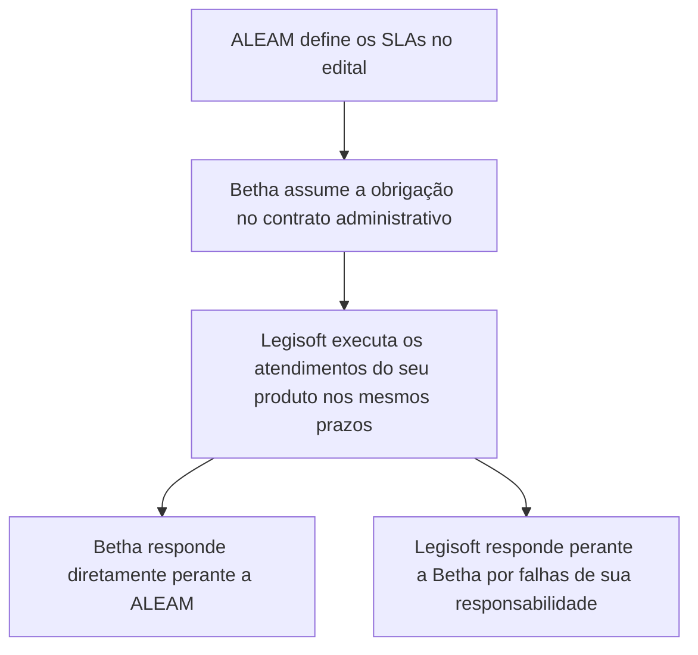

# Leitura do contrato Betha Legisoft

Conversa do ChatGPT de 2026-09-16 (última atividade 2026-09-16). Transcrição bruta: **fonte, não verdade curada**. Fatos relevantes devem ser promovidos para as páginas de pessoas, organizações, áreas e decisões.

**Anexos citados:** SLA.pdf

## Giuliano

@Google Drive preciso que você encontre o contrato estabelecido entre Betha e Legisoft. Peço que você leia e entenda todo o contrato para que depois eu solicite uma ação para você.

## ChatGPT

Vou usar o Google Drive para localizar o contrato Betha–Legisoft e fazer uma leitura integral, incluindo anexos ou aditivos vinculados que apareçam na busca. Depois retorno com a confirmação do documento encontrado e um resumo de entendimento, sem executar nenhuma alteração.

## ChatGPT

Encontrei mais de um instrumento relacionado à parceria, inclusive um contrato histórico “Betha + Virtualiza”, uma versão de parceria de 2026, aditivo e um distrato posterior. Estou conferindo o conteúdo e as datas para identificar qual documento efetivamente rege — ou regeu — a relação, evitando tomar uma minuta ou cópia desatualizada como contrato principal.

## ChatGPT

Localizei e li integralmente o contrato vigente entre a Betha e a Legisoft, cuja razão social é **Virtualiza Tecnologia da Informação Ltda.**

Documento principal: [Contrato de Parceria Comercial nº 07/2026](https://drive.google.com/file/d/1rYfhcKrvruLLOxCO9KccmF27RayHgp-0/view)

Meu entendimento abrange:

- objeto e escopo territorial/comercial da parceria;
- responsabilidades operacionais da Betha e da Legisoft;
- implantação, suporte, manutenção, integrações e SLAs;
- regras de prospecção, exclusividade e não concorrência;
- percentuais de repasse, tributos, faturamento e pagamento;
- vigência, renovação e hipóteses de rescisão;
- multas, responsabilização, LGPD e confidencialidade;
- direito de preferência da Betha;
- tabela de preços;
- condições específicas da ALEAM.

Também confirmei que o contrato anterior, de 2020, e seus aditivos foram formalmente encerrados pelo [Distrato do contrato anterior](https://drive.google.com/file/d/1IK9hI67IXhoZApGPIRmklWnsnCPz17Di/view), com efeito retroativo a **1º de junho de 2026**, justamente em razão da celebração do novo Contrato nº 07/2026.

O contrato atual foi assinado pelas partes, com a última assinatura registrada em **17 de junho de 2026**, e possui vigência inicial de 12 meses, prorrogável automaticamente.

Identifiquei ainda alguns pontos de redação que podem exigir atenção na ação seguinte, como divergência entre os prazos de inadimplência de **60 e 90 dias**, duplicidade de penalidade na cláusula 22 e inconsistências por extenso nos valores do Anexo II. Estou pronto para a próxima solicitação.

## Giuliano

Certo. Peço agora que você faça uma análise sobre os prazos de atendimento. Qual é a obrigação do parceiro referente a prazos de atendimento estabelecidos no contrato entre Betha e entidade? Pergunto isso pois iremos participar do processo de licitação da Assembléia Legislativa do Amazonas (ALEAM) e nele constam prazos para atendimento a determinados tipos de chamado.

## ChatGPT

Vou relacionar as cláusulas do contrato Betha–Legisoft com os efeitos práticos dos SLAs previstos no contrato administrativo da ALEAM. Também vou verificar se o edital/termo de referência da ALEAM está no Drive, para distinguir o que já é obrigação expressa do parceiro do que dependerá dos prazos específicos do certame.

## ChatGPT

Sim. Pelo contrato nº 07/2026, a Legisoft/Virtualiza está obrigada a cumprir os prazos de atendimento assumidos pela Betha perante a ALEAM, desde que esses prazos estejam relacionados ao produto Legisoft e que a Betha forneça os acessos e informações necessários.

A estrutura jurídica e operacional funciona assim:

### 1. Obrigação expressa de cumprir os prazos da ALEAM

A regra mais direta está na cláusula 4ª, §3º:

> “Os prazos de execução dos serviços da PARCEIRA deverão respeitar o previsto no contrato firmado entre o ente público e a BETHA e serão acompanhados via ferramenta de atendimento.”

Portanto, os prazos estabelecidos no edital e posteriormente incorporados ao contrato administrativo Betha–ALEAM passam a ser obrigatórios para a Legisoft, ainda que não estejam reproduzidos individualmente no contrato de parceria.

Isso alcança, em princípio:

- prazo de resposta inicial;
- prazo para início do atendimento;
- prazo de solução;
- prazo de contorno ou solução provisória;
- prazo de restabelecimento do sistema;
- atendimento de chamados críticos, urgentes, altos, médios ou baixos;
- disponibilidade do sistema;
- obrigações de atualização, correção e manutenção.

### 2. Responsabilidade da Legisoft pelo atendimento

A cláusula 7ª atribui expressamente à parceira:

- suporte pós-implantação aos usuários do produto Legisoft;
- esclarecimento de dúvidas;
- orientações operacionais;
- demonstração dos recursos;
- resolução de problemas técnicos;
- manutenção e atualização do produto;
- execução das solicitações encaminhadas pelo sistema de atendimento da Betha.

A alínea “e” é particularmente importante: a Legisoft deve atender aos chamados nos prazos definidos nos contratos firmados com o ente público — SLA — e com qualidade.

Assim, se a ALEAM determinar, por exemplo, que um chamado crítico deve ser iniciado em 30 minutos e solucionado em quatro horas, a obrigação operacional de cumprir esse prazo será da Legisoft quando o incidente estiver no sistema de sua propriedade ou na atividade sob sua responsabilidade.

### 3. A Betha continua sendo responsável perante a ALEAM

Embora a execução técnica seja da Legisoft, o contrato administrativo será firmado entre Betha e ALEAM. Isso significa que, perante a Assembleia, a responsável formal pelo cumprimento dos SLAs será a Betha.

A Betha não poderá justificar eventual descumprimento perante a ALEAM apenas alegando que o atraso foi causado pela parceira. Na relação externa:

- a ALEAM cobra e eventualmente penaliza a Betha;
- a Betha cobra da Legisoft o cumprimento das obrigações transferidas;
- se a falha for da Legisoft, a Betha poderá buscar ressarcimento, aplicar as consequências contratuais e exercer direito de regresso.

A cláusula 7ª, §§1º e 2º, estabelece que a Legisoft responde pelos atos e omissões próprios, de empregados, prepostos e subcontratados. Essa responsabilidade abrange despesas de defesa, prejuízos, condenações, perdas e danos e até lucros cessantes.

Portanto, se a Betha for multada pela ALEAM por um descumprimento comprovadamente causado pela Legisoft, existe fundamento contratual para exigir o ressarcimento da parceira. Será necessário demonstrar:

1. que o atendimento era responsabilidade da Legisoft;
2. que a demanda foi corretamente encaminhada;
3. que a Betha forneceu acessos, dados e condições necessárias;
4. que o prazo aplicável era conhecido;
5. que o atraso decorreu da ação ou omissão da Legisoft;
6. qual foi o prejuízo efetivamente causado à Betha.

### 4. Condições para caracterizar o descumprimento da Legisoft

A obrigação não é completamente automática em qualquer situação. O contrato estabelece algumas condições importantes.

A Betha deve fornecer à Legisoft:

- acesso ao sistema de atendimento;
- dados essenciais para o atendimento;
- informações necessárias sobre o incidente;
- acessos técnicos e condições operacionais;
- integrações e infraestrutura sob sua responsabilidade.

A cláusula 4ª determina que, se a Betha não fornecer essas condições e isso impossibilitar a prestação do serviço, não poderá alegar inadimplemento da Legisoft.

Além disso, os chamados precisam ser registrados no Sistema de Atendimento Betha ou encaminhados por outro meio cujo recebimento seja confirmado pela Betha. Isso torna essencial que o fluxo de atendimento preserve:

- data e hora de abertura;
- classificação e criticidade;
- descrição completa;
- produto ou componente afetado;
- evidências e anexos;
- responsável pelo atendimento;
- data e hora do repasse à Legisoft;
- interações e pausas justificadas;
- data e hora da solução.

Sem essa rastreabilidade, poderá haver dificuldade para atribuir responsabilidade pelo descumprimento.

### 5. Obrigação de analisar os prazos antes da licitação

A cláusula 7ª, alínea “h”, exige que a Legisoft analise os editais encaminhados pela Betha no prazo máximo de 48 horas — dois dias úteis.

Esse dispositivo é estratégico para o caso da ALEAM. Antes da apresentação da proposta, a Betha deve encaminhar formalmente à Legisoft:

- edital;
- termo de referência;
- matriz de criticidade dos chamados;
- prazos de resposta e solução;
- horários de cobertura;
- exigência de atendimento 24x7, se houver;
- disponibilidade mínima exigida;
- multas e glosas;
- regras para contagem, suspensão e encerramento dos chamados.

A Legisoft deve responder formalmente se possui capacidade técnica e operacional para cumprir todos esses requisitos. Essa manifestação é importante porque a Betha assumirá integralmente a obrigação perante a ALEAM.

### 6. Consequências do descumprimento

Dependendo da gravidade e recorrência, o descumprimento dos SLAs pela Legisoft pode gerar:

- notificação para correção;
- responsabilização pelos prejuízos causados;
- ressarcimento de multas ou condenações suportadas pela Betha;
- aplicação da cláusula penal;
- retenção de valores dentro dos limites contratuais;
- rescisão motivada;
- obrigação de continuar mantendo e atualizando o sistema nos contratos administrativos em andamento.

A cláusula 24 estabelece multa genérica de até 10% do valor anualizado estimado do contrato administrativo afetado, observados gravidade, proporcionalidade, notificação e oportunidade de correção. Perdas e danos que superarem a multa também podem ser exigidos.

Entretanto, falhas formais sanáveis ou atrasos diretamente decorrentes de omissão, indisponibilidade de integração, acesso ou providência da Betha não devem gerar essa multa.

### Conclusão

A interpretação contratual mais segura é:

> A Legisoft está obrigada a cumprir integralmente os prazos de atendimento e solução definidos no futuro contrato Betha–ALEAM para todos os chamados relacionados ao produto Legisoft e às atividades sob sua responsabilidade. A Betha continuará sendo a responsável direta perante a ALEAM, mas poderá responsabilizar a Legisoft internamente quando o descumprimento decorrer comprovadamente de sua ação ou omissão.

Antes da participação na licitação, recomendo obter uma declaração formal da Legisoft confirmando que:

1. recebeu e analisou todo o edital e o termo de referência;
2. compreendeu a classificação e os prazos dos chamados;
3. possui estrutura para cumprir os SLAs;
4. aceita os prazos como obrigações vinculadas ao contrato de parceria;
5. reconhece sua responsabilidade por prejuízos causados por descumprimentos de sua competência.

Não localizei no Drive o edital ou o termo de referência específico da ALEAM. Para avaliar se os prazos são exequíveis e quais apresentam maior risco para a Betha, precisarei desse documento ou da tabela de SLAs do certame.

## Giuliano

No documento anexo constam as informações das SLAs do processo da ALEAM. Avalie o que foi estipulado neste documento fazendo o cruzamento com o contrato da Betha e Virtualiza.

## ChatGPT

Vou usar a leitura especializada de PDF para extrair e conferir visualmente a tabela de SLAs. Em seguida, cruzarei cada prazo, condição de contagem e penalidade da ALEAM com as obrigações que a Virtualiza assumiu no Contrato nº 07/2026, destacando lacunas e riscos para a Betha.

## ChatGPT

O cruzamento dos documentos indica que a Virtualiza/Legisoft está contratualmente obrigada a cumprir os SLAs da ALEAM relativos ao Legisoft. Contudo, o documento da ALEAM possui ambiguidades relevantes que devem ser esclarecidas antes da proposta, porque a Betha será a única responsável perante a Assembleia.

## 1. SLAs estabelecidos pela ALEAM

O documento classifica as solicitações por tipo e criticidade:

| Tipo | Criticidade | Prazo máximo |
|---|---|---:|
| Erros ou dúvidas | Extremamente grave | 4 horas |
| Erros ou dúvidas | Muito grave | 8 horas |
| Erros ou dúvidas | Pouco grave | 24 horas |
| Erros ou dúvidas | Sem gravidade | 72 horas |
| Melhorias ou atualizações legais | Não aplicável | Negociado entre as partes |

O item 9.6 não fala apenas em resposta ou início do atendimento. Ele determina que:

> “A contratada deverá solucionar os problemas indicados nos chamados de serviços nos prazos definidos.”

Portanto, a interpretação mais conservadora — e mais segura para a Betha — é que 4, 8, 24 e 72 horas são prazos máximos para a efetiva solução, e não somente para acusar recebimento, classificar ou iniciar o atendimento.

## 2. Como isso vincula a Virtualiza

O contrato Betha–Virtualiza contém três disposições que fazem os SLAs da ALEAM alcançarem diretamente a parceira.

### Cláusula 4ª, §3º

Determina que os prazos de execução da Virtualiza deverão respeitar o contrato firmado entre a Betha e o ente público.

### Cláusula 7ª, alínea “e”

Obriga a Virtualiza a:

- executar as solicitações encaminhadas pelo Sistema de Atendimento Betha;
- cumprir os prazos dos contratos firmados com o ente público;
- observar os respectivos SLAs;
- prestar os atendimentos com qualidade.

### Cláusula 7ª, alíneas “c” e “d”

Atribui à Virtualiza:

- suporte pós-implantação;
- esclarecimento de dúvidas;
- orientação operacional;
- resolução de problemas técnicos;
- manutenção e atualização do Legisoft.

Consequentemente, para os chamados relacionados ao Legisoft, a Virtualiza deve solucionar:

- chamados extremamente graves em até 4 horas;
- chamados muito graves em até 8 horas;
- chamados pouco graves em até 24 horas;
- chamados sem gravidade em até 72 horas.

O Anexo II, específico da ALEAM, não afasta essas obrigações. Ao contrário, ele determina que os produtos e serviços fornecidos pela Virtualiza devem estar em conformidade com as especificações acordadas e ser adequados às finalidades propostas.

## 3. Quem define a criticidade

O item 9.7 do documento da ALEAM estabelece que a classificação por tipo e criticidade é responsabilidade do responsável técnico da ALEAM, no momento da solicitação.

A Betha e a Virtualiza podem auxiliar na classificação, mas não possuem poder unilateral para reduzi-la.

Isso representa um risco importante. Se a ALEAM abrir um chamado como “extremamente grave”, o prazo de quatro horas começará a ser aplicado conforme essa classificação, ainda que a Virtualiza inicialmente discorde.

O fluxo recomendável é:

1. ALEAM abre e classifica o chamado.
2. Betha registra ou recebe o chamado no canal oficial.
3. Betha encaminha imediatamente à Virtualiza.
4. Virtualiza inicia o diagnóstico sem aguardar discussão sobre a criticidade.
5. Eventual pedido de reclassificação é tratado paralelamente.
6. Enquanto não houver concordância formal da ALEAM, permanece a classificação original.

## 4. Ponto de maior risco: prazo de solução

O documento não separa:

- prazo de resposta;
- prazo de início do atendimento;
- prazo de contorno;
- prazo de solução definitiva.

Existe apenas o “prazo máximo de atendimento”, mas o item 9.6 emprega expressamente o verbo “solucionar”.

Assim, um erro extremamente grave pode exigir a restauração completa do serviço em quatro horas. Isso é mais rigoroso do que um SLA que exige apenas resposta em quatro horas.

Essa obrigação pode incluir:

- diagnóstico;
- correção de código;
- testes;
- publicação da versão;
- atualização do ambiente;
- validação pela ALEAM.

Para uma solução legislativa, especialmente durante sessões ou votações, quatro horas para solução definitiva pode ser um compromisso operacional elevado.

## 5. Ausência de regra para contagem dos prazos

O documento não esclarece se as horas são:

- corridas ou úteis;
- limitadas ao horário comercial;
- aplicáveis em finais de semana e feriados;
- contadas durante sessões noturnas;
- suspensas enquanto a ALEAM presta informações;
- suspensas quando a Betha ou a ALEAM precisa validar a solução;
- aplicáveis em regime 24x7.

Na ausência de definição, existe o risco de interpretação como horas corridas, especialmente nos chamados extremamente graves, que tratam de sistema inativo e atividades legislativas interrompidas.

Exemplo: um chamado extremamente grave aberto às 22h pode ser interpretado como solucionável até as 2h, mesmo que não exista plantão formalmente previsto.

## 6. Sobreposições problemáticas entre “erro” e “melhoria”

A definição de “Erros” da ALEAM inclui:

> “quando se tratar de melhorias e as novas funcionalidades não estejam de acordo com os requisitos definidos.”

Já “Melhorias” compreende alterações de código ou novas rotinas decorrentes de mudanças na realidade do cliente, procedimentos e processos.

A distinção adequada parece ser:

| Situação | Classificação provável |
|---|---|
| Funcionalidade existente deixou de funcionar | Erro |
| Funcionalidade executa de forma diferente do requisito aprovado | Erro |
| Nova funcionalidade entregue não atende ao requisito acordado | Erro |
| ALEAM solicita comportamento que não fazia parte do requisito | Melhoria |
| Mudança de processo interno da ALEAM | Melhoria |
| Alteração obrigatória decorrente de legislação | Atualização legal |

Sem critérios de aceite e documentação dos requisitos, uma solicitação de evolução poderá ser classificada pela ALEAM como erro e ficar submetida ao prazo de 4, 8, 24 ou 72 horas.

## 7. Condições que limitam a responsabilidade da Virtualiza

O contrato protege a Virtualiza quando o atendimento depender de uma providência não cumprida pela Betha.

A cláusula 4ª estabelece que a Betha deve fornecer:

- acesso;
- dados essenciais;
- informações necessárias;
- canal de atendimento;
- infraestrutura e integrações sob sua responsabilidade.

Quando a falta dessas condições impossibilitar o serviço, a Betha não poderá atribuir inadimplemento à Virtualiza.

Também não devem ser imputados à Virtualiza atrasos causados por:

- indisponibilidade de API da Betha;
- falha de infraestrutura da Betha;
- ausência de acesso ao ambiente;
- falta de dados para reprodução;
- demora da ALEAM na validação;
- dependência de terceiros;
- solicitação não encaminhada pelo canal contratualmente reconhecido.

Entretanto, essas exceções precisam ser documentadas no chamado. Perante a ALEAM, a responsabilidade contratual continuará concentrada na Betha.

## 8. Risco decorrente da adjudicação global

O item 10 do documento afirma que haverá concentração da responsabilidade em um único contratado. Esse contratado será a Betha.

Isso significa que a ALEAM não precisará distinguir se o problema ocorreu:

- no produto Betha;
- no Legisoft;
- na integração;
- na infraestrutura;
- no atendimento da Virtualiza.

Para a ALEAM, toda a solução será responsabilidade da Betha. A divisão interna de responsabilidades somente produzirá efeitos na relação Betha–Virtualiza.

## 9. Consequências para a Virtualiza

Se a Virtualiza descumprir um SLA por motivo sob sua responsabilidade, poderá ficar sujeita a:

- notificação para regularização;
- ressarcimento dos prejuízos da Betha;
- direito de regresso por multas impostas pela ALEAM;
- retenção de valores dentro dos limites contratuais;
- multa contratual;
- rescisão motivada;
- indenização por perdas, danos e lucros cessantes.

A cláusula penal geral corresponde a 10% do valor anualizado estimado do contrato administrativo afetado, desde que exista infração grave ou reiterada, notificação e oportunidade de defesa ou correção.

Contudo, o repasse automático de uma multa aplicada pela ALEAM à Virtualiza não deve ser feito sem demonstrar o nexo causal. A Betha deverá comprovar que:

1. o chamado era de responsabilidade da Virtualiza;
2. a criticidade foi corretamente atribuída;
3. o prazo aplicável estava claro;
4. a Virtualiza recebeu o chamado em tempo;
5. a Betha forneceu todos os acessos e informações;
6. não houve dependência impeditiva da Betha, da ALEAM ou de terceiro;
7. o atraso da Virtualiza causou a penalidade.

## 10. Principais lacunas a esclarecer com a ALEAM

Antes da proposta, recomendo formalizar pedido de esclarecimento contendo, no mínimo:

1. Os prazos de 4, 8, 24 e 72 horas correspondem à solução definitiva ou ao início do atendimento?
2. A contagem ocorre em horas úteis ou corridas?
3. Qual é o horário oficial de suporte?
4. Existe exigência de plantão 24x7?
5. Como ocorre a contagem em finais de semana, feriados e fora do horário administrativo?
6. Em quais hipóteses o relógio do SLA será suspenso?
7. Aguardando informação, acesso ou validação da ALEAM, o prazo fica suspenso?
8. Como serão tratados chamados que dependam de terceiros ou integrações externas?
9. Solução de contorno interrompe a contagem ou somente a solução definitiva?
10. Qual será o canal oficial que registrará o início e o encerramento do prazo?
11. A contratada poderá contestar a classificação? Em qual prazo e por qual procedimento?
12. Existe penalidade específica por descumprimento de cada SLA?
13. Chamados duplicados ou decorrentes da mesma causa serão considerados individualmente?
14. Qual é o critério para diferenciar erro de melhoria?

## Conclusão executiva

O contrato Betha–Virtualiza é suficiente para obrigar a Virtualiza a observar os SLAs da ALEAM referentes ao Legisoft. Não é necessário um novo aditivo apenas para que os prazos de 4, 8, 24 e 72 horas sejam aplicáveis.

Porém, considero arriscado participar do processo sem duas providências:

- esclarecer formalmente com a ALEAM as regras de contagem e o significado de “solucionar”;
- obter da Virtualiza uma manifestação formal de capacidade e aceite dos SLAs, incluindo disponibilidade fora do horário comercial, escalonamento, plantão e responsabilidade por correções de código.

Minha avaliação é que o maior risco não está na vinculação contratual da Virtualiza — que é clara —, mas na Betha assumir perante a ALEAM prazos de solução definitiva sem regras de contagem, suspensão, plantão e dependências.
